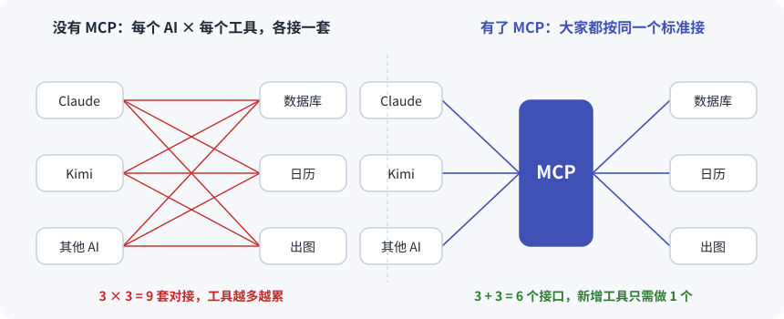
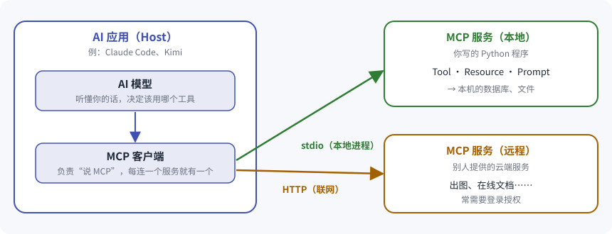
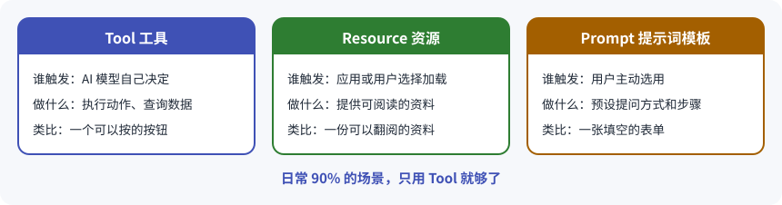
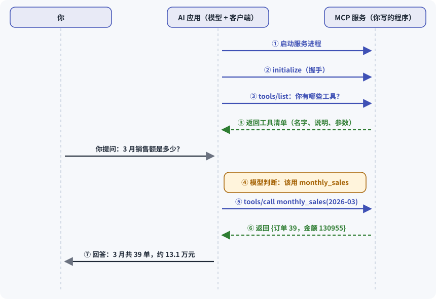

# 第 1 章　原理：MCP 到底是什么

<div class="voice"><b>🎧 语音版</b><audio controls preload="none" src="../../assets/audio/mcp-01.m4a"></audio><span>约 5 分钟</span></div>

??? note "文字稿（点击展开）"
    --8<-- "mcp-01.txt"

!!! abstract "本章目标"
    学完你能：① 用一句话向别人解释 MCP；② 说出 MCP 里的三个角色和三类能力；③ 看懂一次工具调用在底层发生了什么。

## 1.1　先看问题：为什么需要 MCP

AI 助手本身只会“读文字、写文字”。想让它查数据库、读日历、发邮件，必须给它接上外部工具。

**没有统一标准时**：每个 AI 产品 × 每个工具，都要单独写一套对接。

```
        数据库   日历   邮件   出图
Claude   ✍️      ✍️     ✍️     ✍️      ← 4 套对接
Kimi     ✍️      ✍️     ✍️     ✍️      ← 又是 4 套
其他AI   ✍️      ✍️     ✍️     ✍️      ← 再 4 套
```

**有了 MCP**：工具只按标准做一次，所有支持 MCP 的 AI 都能用。

```
Claude ┐                      ┌ 数据库
Kimi   ├──  MCP 标准接口  ──┤ 日历
其他AI ┘                      └ 邮件 / 出图 …
```

就像手机充电口统一成 USB-C：**充电器（工具）只做一次，所有手机（AI）都能插**。

{ .diagram loading=lazy }

<p class="fig-caption">图 1-1　3 个 AI × 3 个工具：没有标准要 9 套对接，有标准只需 6 个接口。工具和 AI 越多，差距越大。</p>

!!! quote "一句话定义"
    **MCP（Model Context Protocol，模型上下文协议）是 AI 应用与外部工具、数据之间的开放标准接口。**

## 1.2　三个角色

| 角色 | 是什么 | 你的例子 |
|---|---|---|
| **Host（宿主）** | 你直接使用的 AI 应用 | Claude Code、Claude 桌面版、Kimi CLI |
| **Client（客户端）** | 宿主内部负责“说 MCP”的部分，每连一个服务就有一个 | 你看不见，宿主自动处理 |
| **Server（服务端）** | 真正提供工具和数据的程序 | 你写的数据库查询服务 |

!!! note "最常见的误解"
    MCP 自己**不做判断**。“该用哪个工具”是 **AI 模型**决定的；MCP 只负责让工具能被统一地发现和调用。

{ .diagram loading=lazy }

<p class="fig-caption">图 1-2　AI 应用内部有“模型”和“客户端”；客户端通过 stdio（本地进程）或 HTTP（联网）连接各个服务。</p>

## 1.3　服务端能提供的三类能力

| 能力 | 谁来触发 | 作用 | 类比 |
|---|---|---|---|
| **Tool（工具）** | AI 模型自己决定调用 | 执行动作或查询：查库、发请求、算数 | 一个可以按的按钮 |
| **Resource（资源）** | 应用或用户选择加载 | 提供可阅读的资料：文件、表结构、文档 | 一份可以翻阅的资料 |
| **Prompt（提示词模板）** | 用户主动选用 | 预设好的提问方式和步骤 | 一张填空的表单 |

日常 **90% 的场景只用 Tool**。Resource 和 Prompt 在第 3 章的示例里会各演示一次。

{ .diagram loading=lazy }

<p class="fig-caption">图 1-3　三类能力的区别：谁来触发、做什么、怎么类比。</p>

## 1.4　两种连接方式（传输）

| 方式 | 服务跑在哪 | 适合 | 例子 |
|---|---|---|---|
| **stdio（本地进程）** | 你自己电脑上，由 AI 应用启动 | 访问本地文件、本地数据库 | 本课程的示例 |
| **HTTP（远程服务）** | 别人的服务器 | 云端服务，常需要登录授权 | 在线出图、在线文档 |

!!! tip "选哪种"
    要碰**本机数据**，用 stdio：数据不出电脑。要用**别人提供的云服务**，用 HTTP。

## 1.5　一次调用在底层发生了什么

你说：“2026 年 3 月销售额多少？”

```
① 启动    宿主启动 server 进程（stdio），或连上远程地址
② 握手    client → server:  initialize          （互相确认版本和能力）
③ 点名    client → server:  tools/list          （你有哪些工具？）
          server → client:  [list_tables, monthly_sales, ...]  含每个工具的说明和参数
④ 决策    模型看到工具清单 + 你的问题，决定调用 monthly_sales
⑤ 调用    client → server:  tools/call  {name: monthly_sales, arguments: {month: "2026-03"}}
⑥ 返回    server → client:  {orders: 39, amount: 130955.0, ...}
⑦ 回答    模型把结果整理成人话告诉你
```

**▶ 动画演示**（自动循环播放，约 20 秒一轮）：

{ .diagram loading=lazy }

<p class="fig-caption">图 1-4　按时间顺序，一步一步出现：启动 → 握手 → 点名 → 提问 → 决策 → 调用 → 返回 → 回答。</p>

底层通信使用 **JSON-RPC**（一种简单的“请求—响应”JSON 格式）。第 3 章你会亲眼看到这些消息。

!!! info "关键洞察：工具的‘说明书’就是模型的全部线索"
    模型**看不到你的代码**，它只看到第 ③ 步返回的：工具名、描述、参数。
    所以 **描述写得好不好，直接决定 AI 会不会用、会不会用对**。第 4 章专门讲这个。

## 1.6　MCP 不是什么

- ❌ 不是某个 AI 模型。
- ❌ 不是插件商店。它只是协议，市面上的服务质量参差不齐，要自己甄别（第 5 章）。
- ❌ 不会自动让 AI 变聪明。它只让 AI **够得着**更多工具，用得好不好仍取决于工具设计和权限控制。
- ❌ 不等于“能写入/能操作”。很多最有价值的 MCP 是**只读**的。

## 本章小结

1. MCP = AI 和工具之间的**统一接口标准**。
2. 三个角色：Host、Client、Server。三类能力：Tool、Resource、Prompt。
3. 工具的**名字、描述、参数**是模型选工具的唯一依据。

**自测：** 能不看本页，用自己的话讲清楚 1.5 的七步吗？讲不清的步骤回头再读。

下一章：[安装和使用现成的 MCP](02-use-existing.md)
