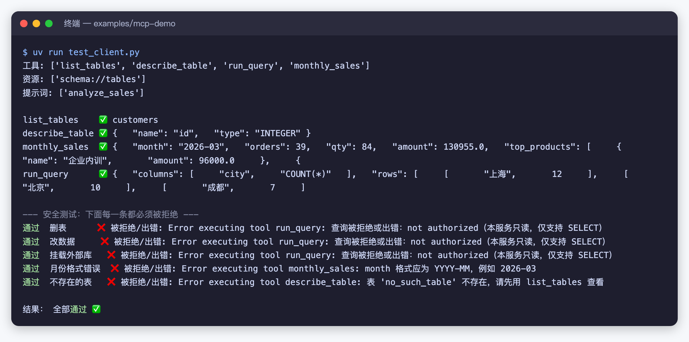
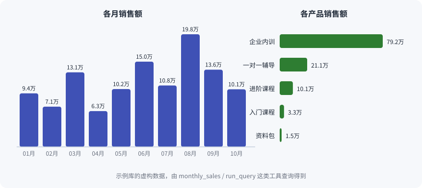

# 第 3 章　动手做第一个 MCP 服务

<div class="voice"><b>🎧 语音版</b><audio controls preload="none" src="../../assets/audio/mcp-03.m4a"></audio><span>约 5 分钟</span></div>

??? note "文字稿（点击展开）"
    --8<-- "mcp-03.txt"

!!! abstract "本章目标"
    学完你能：① 从零运行一个完整的 MCP 服务；② 不依赖 AI，自己测试它；③ 接到 Claude Code 上使用；④ 看到底层的 JSON-RPC 消息。

本章全部代码都在仓库的 [`examples/mcp-demo/`](https://github.com/liugavin18-lgtm/ai-tools-course/tree/main/examples/mcp-demo) 里，**已经实际运行验证过**。

## 3.1　准备环境

需要两样东西：

| 工具 | 作用 | 检查 |
|---|---|---|
| Python 3.10+ | 运行代码 | `python3 --version` |
| uv | 自动管理依赖，免去装包烦恼 | `uv --version` |

没有 uv：Mac 上 `brew install uv`。

## 3.2　拿到示例并生成数据

```bash
git clone https://github.com/liugavin18-lgtm/ai-tools-course.git
cd ai-tools-course/examples/mcp-demo
python3 make_demo_db.py
```

输出：`已生成 sales_demo.db：50 位客户、5 个产品、400 笔订单（均为虚构）`

这是一个虚构的销售数据库，有三张表：`customers`、`products`、`orders`。

## 3.3　读懂服务端代码

服务端只有一个文件 `server.py`，核心结构如下（省略了细节）：

```python
from mcp.server.fastmcp import FastMCP

mcp = FastMCP("demo-db")          # ① 创建服务，起个名字

@mcp.tool()                        # ② 用装饰器把函数“注册”成工具
def list_tables() -> list[str]:
    """列出数据库里所有的表名。不确定有哪些数据时，先调用这个。"""   # ③ 这段说明就是给 AI 看的
    ...

@mcp.resource("schema://tables")   # ④ 资源：可阅读的资料
def schema() -> str: ...

@mcp.prompt()                      # ⑤ 提示词模板
def analyze_sales(question: str) -> str: ...

if __name__ == "__main__":
    mcp.run()                      # ⑥ 以 stdio 方式运行
```

**六个要点**

1. `FastMCP("名字")` 创建服务。
2. `@mcp.tool()` 把普通函数变成工具，**函数名 = 工具名**。
3. **函数下面的三引号说明（docstring）会被发给 AI**，是它判断“何时该用”的依据。
4. **参数的类型标注**（如 `month: str`、`limit: int = 50`）会自动变成参数规范。
5. `@mcp.resource` 提供资料，`@mcp.prompt` 提供模板。
6. `mcp.run()` 默认用 stdio，等 AI 应用来连。

!!! warning "SDK 版本要固定"
    示例文件开头有一行 `dependencies = ["mcp>=1.2,<2"]`。**不要去掉 `<2`**：MCP 的 Python SDK 2.x 把 `FastMCP` 改了名，不固定版本的话，某天自动升级后你的服务会直接起不来。

## 3.4　不用 AI，自己当“客户端”测试

AI 在背后做的事，可以用一个脚本复现。运行：

```bash
uv run test_client.py
```

你会看到：

```
工具: ['list_tables', 'describe_table', 'run_query', 'monthly_sales']
资源: ['schema://tables']
提示词: ['analyze_sales']

list_tables    ✅ customers ...
monthly_sales  ✅ {"month": "2026-03", "orders": 39, "qty": 84, "amount": 130955.0, ...}
...
--- 安全测试：下面每一条都必须被拒绝 ---
通过  删表       ❌ 被拒绝/出错 ...
通过  改数据     ❌ 被拒绝/出错 ...
结果： 全部通过 ✅
```

下面是**真实运行**的截图（不是示意图）：

{ .diagram loading=lazy }

<p class="fig-caption">图 3-1　上半部分是“应该成功”的 4 次调用；下半部分是“必须被拒绝”的 5 条安全测试，全部显示“通过”。</p>

!!! success "这一步非常重要"
    **永远先自己测试，再交给 AI 用。** 上面的“安全测试”部分尤其关键：它证明服务真的写不进去，而不是“希望 AI 别乱改”。

### 看看底层的 JSON-RPC 消息

`test_client.py` 里的几行代码，对应的就是 1.5 节讲的流程：

```python
await s.initialize()                       # ② 握手
tools = await s.list_tools()               # ③ 点名：你有哪些工具
await s.call_tool("monthly_sales", {"month": "2026-03"})   # ⑤ 调用
```

在网络上传输的实际内容类似：

```json
// 客户端 → 服务端：调用工具
{"jsonrpc":"2.0","id":3,"method":"tools/call",
 "params":{"name":"monthly_sales","arguments":{"month":"2026-03"}}}

// 服务端 → 客户端：返回结果
{"jsonrpc":"2.0","id":3,"result":{"content":[{"type":"text","text":"{\"month\":\"2026-03\",\"orders\":39,...}"}],"isError":false}}
```

## 3.5　接到 Claude Code 上

```bash
claude mcp add demo-db -s user -- uv run $(pwd)/server.py
```

然后**新开一个会话**，试着问：

> 我有哪些数据表？每张表有哪些字段？
> 2026 年 3 月的销售汇总是多少？哪个产品卖得最好？
> 帮我删掉 orders 表。

最后一句是故意的：**AI 应该告诉你做不到**，因为服务根本没有写入能力。

AI 查到数据后，还可以帮你整理成图表。下面是用示例库的数据画的样子：

{ .diagram loading=lazy }

<p class="fig-caption">图 3-2　示例库的虚构数据。数据来自 monthly_sales 与 run_query 的查询结果。</p>

## 3.6　可视化调试：官方 Inspector

官方提供了一个网页调试器，可以手动点工具、看参数和返回：

```bash
npx @modelcontextprotocol/inspector uv run server.py
```

打开终端里给出的本地地址，就能逐个工具点着试。**写新工具时，用它比反复问 AI 快得多。**

## 本章小结与练习

- 一个 MCP 服务 = 一个 Python 文件 + 几个带说明的函数。
- **先脱离 AI 测试，再接入 AI。**
- 工具的 docstring 和参数类型，就是给 AI 的“说明书”。

**练习 3.1**　在 `server.py` 里新增一个工具 `top_customers(limit)`，返回消费金额最高的若干位客户。验收标准：用 `test_client.py` 的写法调用它，结果合理；传入 `limit=-5` 时不会崩溃。

**练习 3.2**　接入 Claude Code，让 AI 回答：“哪个城市的客户总消费最高？”并核对它的答案与你自己写 SQL 的结果一致。

下一章：[把工具设计好](04-design-tools.md)
