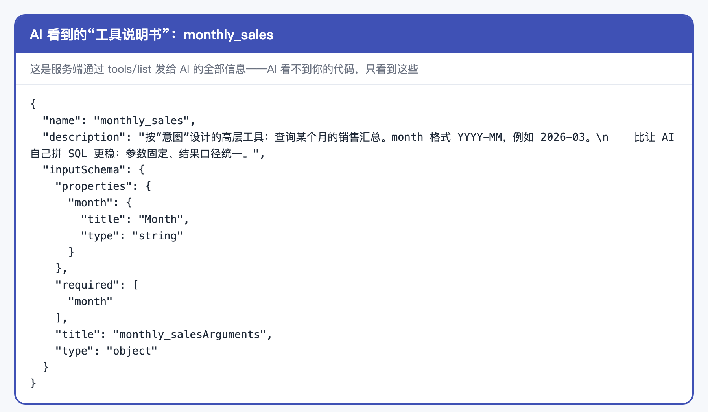

# 第 4 章　把工具设计好

<div class="voice"><b>🎧 语音版</b><audio controls preload="none" src="../../assets/audio/mcp-04.m4a"></audio><span>约 5 分钟</span></div>

??? note "文字稿（点击展开）"
    --8<-- "mcp-04.txt"

!!! abstract "本章目标"
    学完你能：① 判断一个工具设计得好不好；② 写出 AI 能“一看就懂”的描述；③ 避免常见的设计坑。

**核心认识：工具是写给 AI 看的“产品”。** AI 看不到你的代码，只看到名字、描述和参数。设计差，AI 就会选错工具、填错参数、编造结果。

## 4.1　原则一：按“意图”设计，而不是按“技术”设计

| 做法 | 例子 | 问题 |
|---|---|---|
| ❌ 技术导向 | 只提供一个 `run_sql(sql)` | AI 每次自己拼 SQL，口径不统一，容易写错 |
| ✅ 意图导向 | `monthly_sales(month)` | 参数固定，结果口径统一，AI 不会出错 |

**最佳组合：高频需求做成意图工具，保留一个受限的 `run_query` 兜底。** 本课示例就是这么做的。

## 4.2　原则二：名字和描述要让 AI 一看就懂

**好描述的四要素：**

1. **做什么**：一句话讲清。
2. **什么时候用**：触发场景。
3. **参数怎么填**：给格式和例子。
4. **有什么限制**：行数、范围、权限。

| | 示例 |
|---|---|
| ❌ 差 | `"""查询数据"""` |
| ✅ 好 | `"""查询某个月的销售汇总。month 格式 YYYY-MM，例如 2026-03。返回订单数、销量、金额和前三名产品。"""` |

下面是 `monthly_sales` 这个工具，**AI 实际看到的全部内容**（由服务端真实返回，不是手写的）：

{ .diagram loading=lazy }

<p class="fig-caption">图 4-1　注意：只有名字、描述和参数规范。描述里的“格式 YYYY-MM，例如 2026-03”，直接决定 AI 能不能填对参数。</p>

!!! tip "测试方法"
    把工具名、描述、参数单独发给一个没见过代码的同事，问他：“你知道什么时候该用它吗？”他犹豫，AI 就会犹豫。

## 4.3　原则三：参数要“窄”，并且要校验

```python
@mcp.tool()
def monthly_sales(month: str) -> dict:
    if not re.fullmatch(r"\d{4}-(0[1-9]|1[0-2])", month):
        raise ValueError("month 格式应为 YYYY-MM，例如 2026-03")   # 错误信息本身就是教 AI 怎么改
    ...
    cur.execute("... WHERE substr(order_date,1,7)=?", (month,))   # 参数化，绝不拼接字符串
```

- **类型标注写清楚**（`str`、`int`、`list[str]`），它会自动变成参数规范。
- **永远校验输入**，**永远用参数化查询**，不要把 AI 传来的字符串拼进 SQL 或命令。
- AI 传来的参数**不可信**：它可能被诱导，也可能只是理解错了。

## 4.4　原则四：控制返回内容的大小

返回内容会**占用 AI 的上下文**，太多会挤掉重要信息、拖慢速度、增加费用。

| 做法 | 说明 |
|---|---|
| 设行数上限 | 示例里 `MAX_ROWS = 200` |
| 标明是否被截断 | 返回 `truncated: true`，AI 才知道数据不全 |
| 默认值保守 | `limit` 默认 50，而不是“全部” |
| 优先返回汇总 | 描述里提示“统计请用 GROUP BY，不要拉明细自己算” |

## 4.5　原则五：错误信息要“可操作”

| | 示例 |
|---|---|
| ❌ | `Error: failed` |
| ✅ | `表 'ordres' 不存在，请先用 list_tables 查看` |

好的错误信息告诉 AI **错在哪、下一步该怎么做**。AI 往往能据此自己纠正后重试。

## 4.6　原则六：工具数量要克制

- 每个工具的描述都会占用上下文。**工具越多，AI 越容易选错，也越费钱。**
- 经验值：**一个服务 5~10 个工具**。超过就考虑拆成多个服务。
- 合并功能重叠的工具。`get_user`、`fetch_user`、`find_user` 同时存在，AI 一定会犹豫。

## 4.7　原则七：区分“读”和“写”

| 类型 | 特点 | 建议 |
|---|---|---|
| 只读（查询） | 重复调用无副作用 | 可以放心开放 |
| 写入（新增/修改/删除/发送/花钱） | 有副作用，难撤销 | 单独成服务，加人工确认（第 5 章） |

**写操作还要考虑“幂等”**：同一个请求重复执行两次，结果是否仍正确？AI 可能因为超时而重试，不幂等的“扣款”工具会造成重复扣款。

## 4.8　设计检查清单

- [ ] 工具名是动词短语，且互不重叠
- [ ] 描述写了：做什么 / 何时用 / 参数格式 / 限制
- [ ] 参数有类型标注，并做了输入校验
- [ ] 没有任何字符串拼接 SQL / 命令
- [ ] 返回有上限，并标明是否截断
- [ ] 错误信息告诉 AI 如何纠正
- [ ] 总数不超过 10 个
- [ ] 读写分离

## 本章练习

**练习 4.1（找茬）**　下面的工具有哪些问题？列出至少 4 条：

```python
@mcp.tool()
def query(q):
    """查数据"""
    return db.execute("SELECT * FROM orders WHERE " + q).fetchall()
```

??? success "参考答案"
    ① 名字太笼统；② 描述没有说明用途、格式、限制；③ 参数没有类型标注；④ **字符串拼接 SQL，存在注入**；⑤ 没有行数上限，可能返回海量数据；⑥ 没有只读保护；⑦ 没有错误处理。

**练习 4.2**　为练习 3.1 的 `top_customers` 写出符合“四要素”的描述，并通过检查清单自评。

下一章：[安全与权限](05-security.md)
