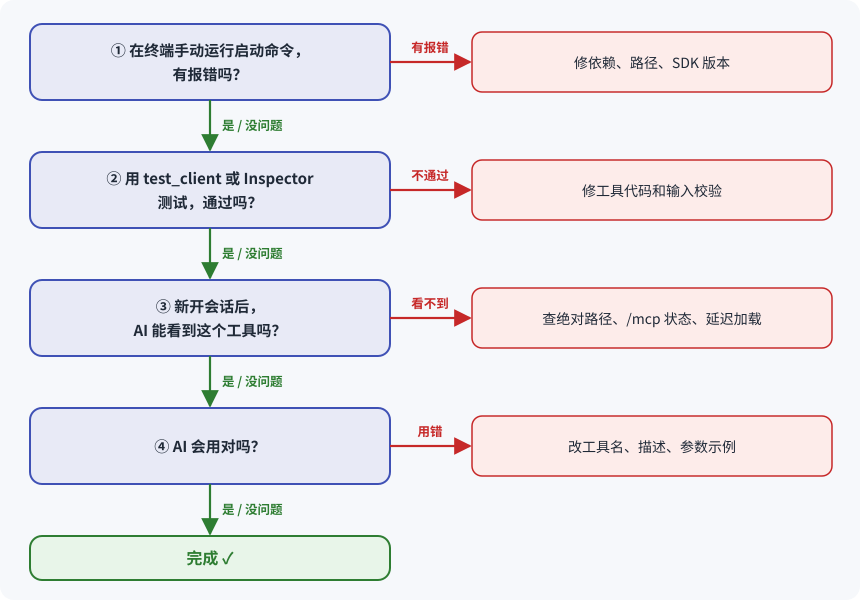

# 第 7 章　排错手册

<div class="voice"><b>🎧 语音版</b><audio controls preload="none" src="../../assets/audio/mcp-07.m4a"></audio><span>约 5 分钟</span></div>

??? note "文字稿（点击展开）"
    --8<-- "mcp-07.txt"

!!! abstract "本章目标"
    遇到问题时，知道按什么顺序查、哪里看到真实报错。

## 7.1　黄金法则：先脱离 AI，让服务单独跑起来

**90% 的 MCP 问题，在你让服务“单独跑起来”的那一刻就能暴露。** 排错顺序：

```
① 服务能手动启动吗？          → 终端里直接运行启动命令
② 服务的功能对吗？            → 用 test_client.py 或 Inspector 测试
③ 配置对吗？                  → claude mcp list / get
④ AI 应用连得上吗？           → 新开会话，/mcp 看状态
⑤ AI 会不会用？               → 检查工具描述，换个问法
```

{ .diagram loading=lazy }

<p class="fig-caption">图 7-1　排错决策树：从上往下逐项检查，每一步“没问题”才进入下一步。</p>

### 手动启动，看真实报错

```bash
uv run /绝对路径/server.py
```

正常情况：程序**停住不动、没有输出**（它在等 AI 应用发消息）。按 `Ctrl+C` 退出。
异常情况：直接打印出报错，比如缺依赖、语法错误、路径不对。

### 手动发一条握手消息

```bash
echo '{"jsonrpc":"2.0","id":1,"method":"initialize","params":{"protocolVersion":"2024-11-05","capabilities":{},"clientInfo":{"name":"t","version":"1"}}}' | uv run /绝对路径/server.py
```

能返回一段包含 `serverInfo` 的 JSON，说明服务本身是好的。

## 7.2　症状 → 原因 → 解决

| 症状 | 最可能的原因 | 怎么办 |
|---|---|---|
| `Connection closed` | **服务启动时就崩了** | 终端手动运行，看真实报错 |
| `No module named ...` | 依赖没装 / 版本不对 | 用 `uv run` 并在文件头声明依赖；**固定版本上限** |
| `FastMCP` 导入失败 | SDK 大版本变了 | 依赖写 `mcp>=1.2,<2` |
| `command not found` | 命令不在 AI 应用的 PATH 里 | **命令和路径都写绝对路径**，如 `/opt/homebrew/bin/uv` |
| 装好了但 AI 看不到工具 | 会话在装之前就开了 | **新开会话** |
| AI 说“没有这个工具”，却去用终端 | 客户端采用按需加载 | 配置加延迟加载标记；提问里明确点名 MCP |
| 工具调用报 `not authorized` | 你的只读防线拦截了它 | 判断是**该拦的**还是**误拦**（见第 6 章坑 2） |
| 第一次调用很慢 | `uv` 在下载依赖 | 先手动运行一次，把依赖缓存好 |
| 远程服务提示需要授权 | OAuth 未完成 | 在 AI 应用里走授权流程，**不要把令牌发给 AI** |
| 返回结果被截断 | 你设置的行数上限 | 看 `truncated` 字段；改用 GROUP BY 汇总 |
| 工具被调用了，但参数总是错 | 描述或类型标注不清晰 | 重写描述，加例子，加输入校验和友好报错 |
| 端口被占用（HTTP 服务） | 别的程序占了端口 | 让系统自动分配空闲端口，别硬占 |

## 7.3　用 Inspector 排查

```bash
npx @modelcontextprotocol/inspector uv run /绝对路径/server.py
```

- 在网页里逐个调用工具，**直接看参数和返回**。
- 适合回答：“这个工具到底返回了什么？”“报错是工具本身的，还是 AI 理解错了？”

## 7.4　AI 用错了，怎么判断是谁的问题

| 现象 | 多半是 |
|---|---|
| 调用了错误的工具 | 描述不清，或工具功能重叠 |
| 工具对了，参数乱填 | 缺少类型标注、格式示例 |
| 工具和参数都对，结果仍错 | 工具实现本身有 bug → 用测试脚本复现 |
| 返回对了，AI 解读错 | 返回结构过于复杂，简化字段名和结构 |
| AI 编造数据 | 查询失败后没有明确报错；错误信息要清楚，并在提示里写“不得编造” |

## 7.5　排错清单（打印出来贴墙上）

- [ ] 终端手动运行，没有报错
- [ ] 脱离 AI 的测试脚本全部通过
- [ ] 配置里命令和路径都是**绝对路径**
- [ ] 新开了会话
- [ ] 依赖版本已固定
- [ ] 工具描述写清了“做什么 / 何时用 / 参数格式 / 限制”

## 本章练习

**练习 7.1（故障演练）**　请故意制造三种故障，并用本章方法定位：

1. 把 `server.py` 里的 `from mcp.server.fastmcp import FastMCP` 改成拼写错误
2. 在 `claude mcp add` 时把路径写成相对路径，换个目录启动 AI
3. 删掉 `sales_demo.db`

每种故障写下：**看到的现象、怎么发现真实原因、怎么修复**。

下一章：[练习与考核](08-exercises.md)
